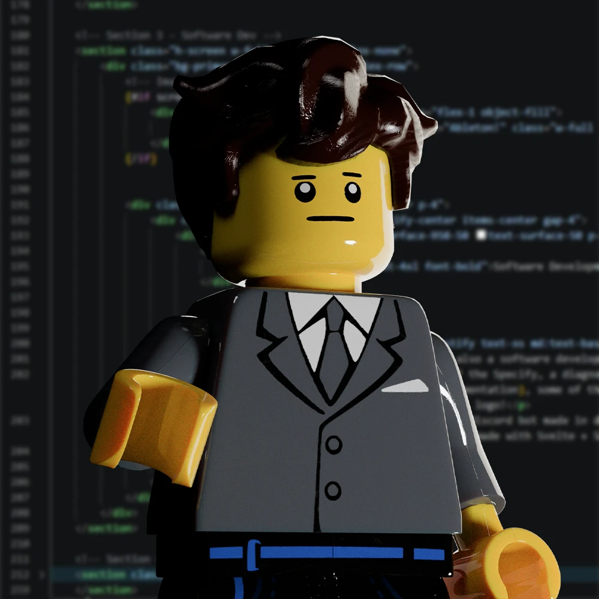
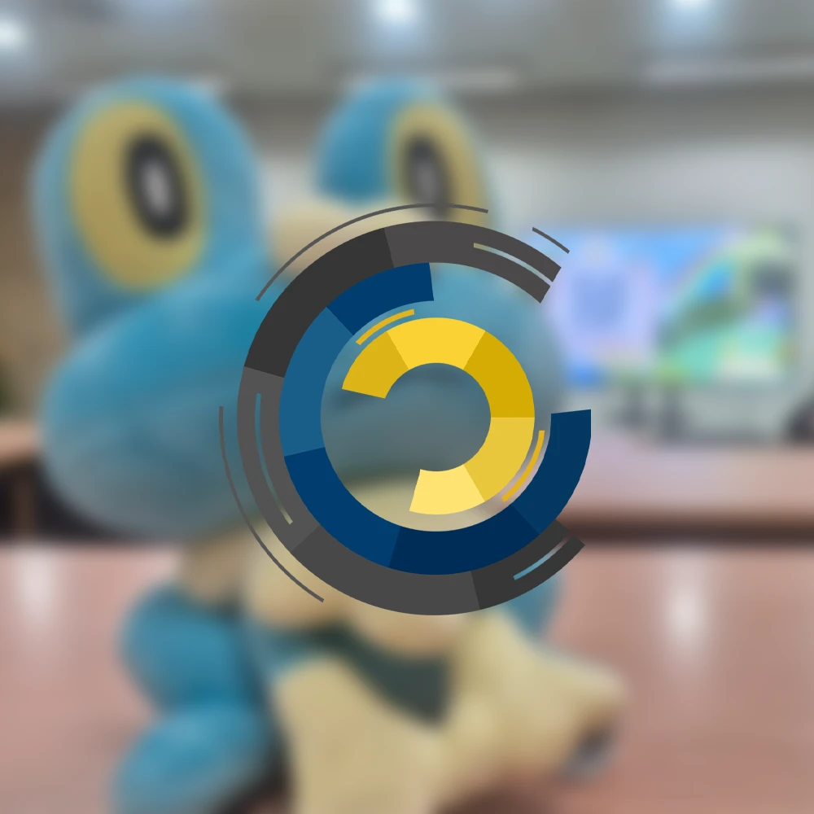
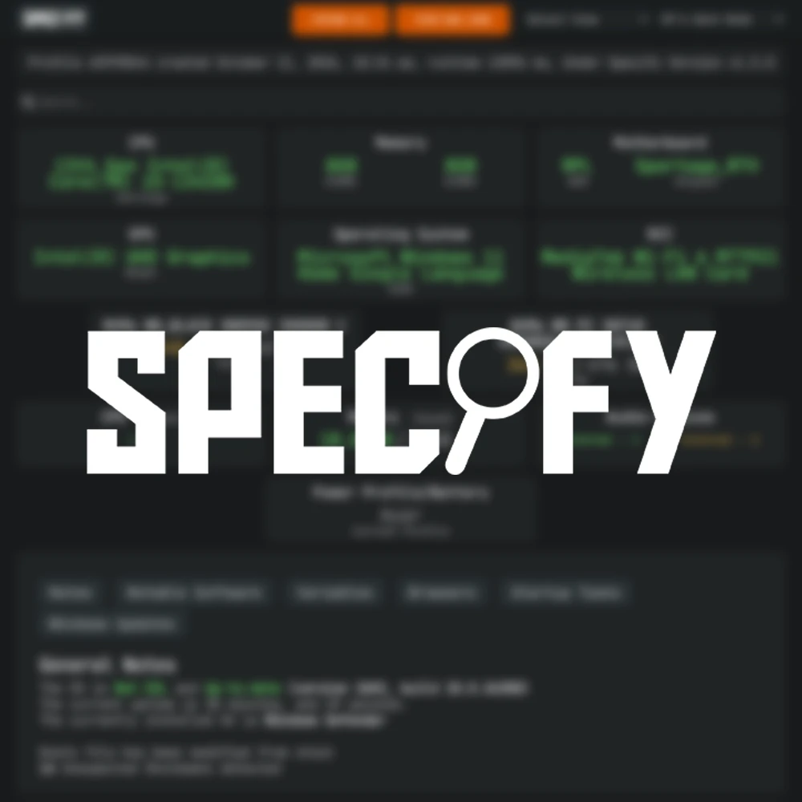
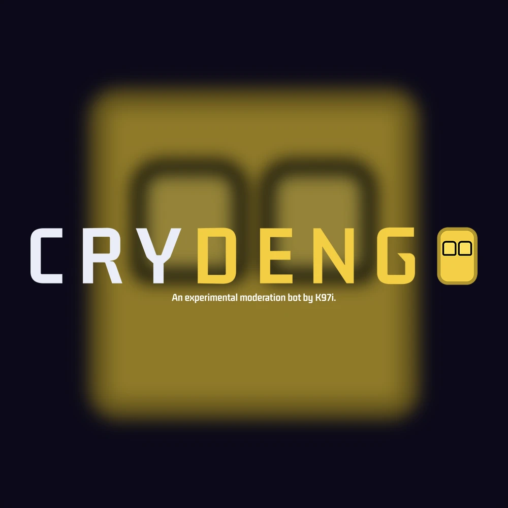

<h1 align="center">K97i - The Intern of All Trades!</h1>

<table width="100%">
    <tr>
        <td width="50%" valign="center">
            <h3 align="center">About Me</h3>
            

                Hello! I'm K97i. (🏳️‍🌈, he/they)  
                I'm a sophomore student from De La Salle University, taking BS Computer Science, Major in Software Technology. I've covered many roles and wore many hats, but I mainly focus on web development!  
                I'm also a (former? retired? taking a break?) electronic music producer, composer and songwriter, with a <a href="https://www.youtube.com/@K97i">YouTube channel</a>.
            

        </td>
        <td width="50%" valign="center">
            
        </td>
    </tr>
</table>

<h3 align="center">Current Roles</h3>

<table width="100%">
    <tr>
        <td width="50%" valign="center">
            

                <h3>Committee Trainee @ LSCS</h3>
                ( 2026 - present )
            

            

                I joined my university's computer science student organiazation, La Salle Computer Society (LSCS). I'm currently serving as a committee trainee under Design and Interface, specializing in Frontend Engineering. 
            

        </td>
        <td>
            
        </td>
    </tr>
    <tr>
        <td width="50%" valign="center">
            

                <h3>UI/UX Engineer @ Specify</h3>
                ( 2022 - present )
            

            

                During the pandemic, I joined the development team of the Specify application, a diagnostic tool originally made for use in r/techsupport. While the job title says UI/UX engineer, I wear a lot of hats for the development of this tool! 
                <ul>
                    <li>
                        Designed and developed the current user interface of Specify in Adobe Illustrator, XAML, and C#. 
                    </li>
                    <li>
                        Working as a maintainer for the viewer for Specify reports, Specified, written in PHP.
                    </li>
                    <li>
                        Currently working on the rewrite of the viewer in Svelte / SkeletonUI. 
                    </li>
                </ul>
            

        </td>
        <td>
            
        </td>
    </tr>
</table>

<h3 align="center">Current Projects</h3>

<table width="100%">
    <tr>
        <td width="50%" valign="center">
            

                <h3>Crydengo</h3>
                ( 2026 - present )
            

            

                I made experimental moderation bot <a href="www.github.com/K97i/crydengo">Crydengo</a>, written in Javascript, using Discord.js. Primarily made for the Foxtale Discord server, it's main feature is its automatic crypto casino spam detection, using Tesseract.js. 
            

        </td>
        <td>
            
        </td>
    </tr>
</table>
